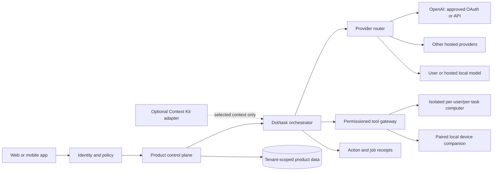

# Architecture Options

Status: exploration. The diagram is a boundary hypothesis, not an accepted
deployment design.



## Candidate Components

- **Client:** web/mobile first; a desktop shell or companion may be needed for
  access to the owner's actual computer.
- **Identity/policy:** authenticated account and tenant membership; server-side
  authorization on every data and tool operation.
- **Control plane:** user settings, Dots, conversations, approvals, schedules,
  notifications, provider connections, and audit receipts.
- **Agent runtime:** model-independent orchestration and tool-call handling.
  Keep provider protocol adapters separate from product permissions.
- **Provider router:** explicitly select an authorized provider/model per user
  or Dot; no silent paid-provider or hosted fallback.
- **Tool gateway:** validate user, tenant, Dot, tool scope, approval, and task
  state before dispatch. Separate local-device tools from cloud-computer tools.
- **Data plane:** product-owned records with explicit tenant ownership;
  conversation history, durable memory, files, provider credentials, and
  activity receipts have distinct access and retention rules.
- **Optional Context Kit adapter:** resolve selected user-approved skills and
  project guidance; never make the private Context Kit repository a runtime
  prerequisite.

## Trust Boundaries

1. Browser/mobile client is untrusted; client-side IDs and permission flags do
   not authorize server actions.
2. Agent/model output is untrusted; tool schemas and server policy constrain
   what it can request.
3. Provider APIs receive the prompt/context needed for each inference request;
   minimize and disclose that data transfer.
4. Each remote computer or execution worker must be isolated by user, task,
   credentials, filesystem, and network policy.
5. A local device companion is a privileged bridge and needs pairing,
   capability scopes, user-visible status, revocation, and signed updates.
6. Third-party connectors have their own credentials, audience, scopes,
   retention, and outbound side effects.

## Product Data Ownership Hypothesis

```text
Tenant
  ├── Users and memberships
  ├── Provider connections (owned by a user; optionally delegated to a Dot)
  ├── Dots and versioned instructions
  ├── Conversations and user-approved memories
  ├── Files / workspace references
  ├── Jobs, approvals, and action receipts
  └── Device and connector grants
```

This is a conceptual ownership map only. Schema, retention, sharing, and
deletion semantics remain open until DOT-004 and DOT-006.

## Architectural Questions

- Can the existing TanStack AI runtime accommodate Responses API OAuth
  requirements and tool-call streaming without a fragile protocol shim?
- Should Codex app-server be an optional agent runtime for local shell/MCP and
  child-agent work, or should the product own those harness functions?
- Does OpenDots' current Intelligence dependency remain behind an interface, or
  should conversation storage move to a product-owned database?
- How will local model inference work when the control plane is hosted remotely?
  The supported endpoint could be on the user's LAN/device or a cloud GPU
  worker; those have different availability and privacy properties.
- Which provider connections are personal to the signed-in user versus
  centrally supplied by the product operator?
